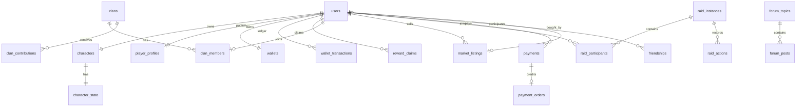

# Phase 3 — PostgreSQL: review of tables, relations and indexes

**Статус:** архитектурный review текущего черновика `db/migrations/0001_initial_hybrid_schema.sql`. Документ не является командой применить SQL. Схема не запускалась ни на production, ни на тестовой БД. Firestore не читался и экспорт не выполнялся.

## 1. Общая модель

Рекомендуемая основа — гибридная схема: критичные связи, балансы, статусы, идентификаторы, сортировка и уникальность находятся в обычных PostgreSQL-колонках; меняющиеся игровые payloads на первом этапе сохраняются в JSONB. Это снижает риск потерять неизвестные поля при первом импорте и позволяет постепенно нормализовать горячие участки.

Firebase Auth остаётся внешним Identity Provider. В PostgreSQL хранится стабильный Firebase UID, но не пароль и не копия токена.

### Основные связи

Примечание: ER-диаграмма показывает логические отношения; конкретные FK и каскадные правила должны быть подтверждены после проверки исходных документов и правил удаления.

## 2. Что уже покрывает черновик 0001

| Домен | Таблицы | Комментарий |
|---|---|---|
| Аккаунт и персонаж | `users`, `characters`, `character_state`, `player_profiles` | Разделены identity, основной персонаж, сохранение и публичная проекция |
| Золото | `wallets`, `wallet_transactions`, `reward_claims` | Есть баланс, ledger и уникальность claim |
| Кланы | `clans`, `clan_members`, `clan_contributions`, `clan_activity` | Нужна отдельная проверка ролей/лидера и вложенных данных |
| Рынок и личная почта | `market_listings`, `direct_messages` | Есть seller/buyer и одноразовый флаг получения вложения |
| Рейды | `raid_instances`, `raid_participants`, `raid_actions` | Ключ действия ограничивает повтор в рамках raid/player/round |
| Мировые события | `clan_wars`, `world_events`, `territories` | Payload пока JSONB |
| Платежи | `payments`, `payment_orders` | Есть provider order ID как ключ |
| Социальные функции | `friendships`, `forum_topics`, `forum_posts`, `chat_messages` | Достаточно для первого наброска, но не полный доменный охват |
| Миграция | `migration_source_documents`, `migration_runs` | Сохраняет источник и отчёт импорта |

## 3. Таблицы, которых не хватает до реализации

Не добавлять их вслепую: сначала сопоставить с фактическими путями и payloads из статического аудита, затем уточнить поля.

| Предлагаемая таблица | Для чего | Основные ключи / связи |
|---|---|---|
| `account_private` | Приватные настройки/поля аккаунта из `priv/{uid}` | PK/FK `firebase_uid → users`; чувствительные секреты вынести в secret manager |
| `duel_instances`, `duel_actions` | Текущее состояние дуэлей и защита от повторного хода/раунда | PK duel ID; FK участники; unique(duel_id, round, actor_uid) |
| `referral_rewards` | Реферальные начисления и статусы | Unique(referrer_uid, invited_uid); claim state |
| `fraud_flags` | Админский список флагов | Индекс (created_at DESC), отдельный UID/kind |
| `outbox_events` | Надёжная доставка realtime и фоновых событий | PK event ID; индекс pending + created_at |
| `notification_jobs` | Планируемые push-напоминания/повторные отправки | status, scheduled_at, attempts; индекс для очереди due |
| `admin_audit` | Кто и почему изменил игровые данные | actor_uid, action, target, reason, created_at |
| `daily_stats` | Агрегаты аналитики | date + metric key unique |
| `system_settings` | Безопасные игровые настройки/промо-флаги | ключ; секреты и VAPID private key здесь не хранить |
| `clan_dungeon_state` | Состояние кланового подземелья/квеста, если подтверждается аудитом | clan_id + cycle/season key |
| `raid_queue` | Ограниченная очередь поиска рейда | статус, created_at, expiry; TTL/очистка |
| `chat_rooms` / `chat_members` | Если текущий чат разделён на комнаты или имеет ACL | room ID, member UID |
| `message_claims` | Одноразовое получение вложений/наград из сообщений | unique(message_id, claimant_uid) |

Для `friends`, `dmi`, `dm`, `chat`, `forum` и `raidq` перед созданием таблиц проверить фактическую структуру и назначение каждого пути: одноимённые коллекции могут иметь разные типы доступа и разные правила удаления.

## 4. Обязательные ограничения целостности

### Пользователи и персонажи
- `users.firebase_uid` — неизменяемый первичный ключ.
- `characters.firebase_uid` — UNIQUE: текущая модель предполагает одного основного персонажа на аккаунт. Если в игре есть/планируются несколько персонажей, эту связь изменить до первой миграции.
- `characters.normalized_name` — UNIQUE; нормализация должна совпадать с текущими правилами регистрации и регистра букв.
- Удаление пользователя не должно автоматически стирать платежи, финансовый ledger и административный аудит. Для этих данных предпочесть soft-delete/анонимизацию, а не каскадное удаление.

### Сохранения
- `character_state.character_id` — PK/FK, одна актуальная запись состояния на персонажа.
- `save_version` монотонно увеличивается при успешной записи.
- Для stale-save применять блокировку строки или optimistic compare-and-swap: UPDATE только при совпадении ожидаемой версии/сессии. Проверка и запись должны быть в одной транзакции.
- Не создавать GIN-индекс на весь JSONB автоматически. Индексировать только поля, которые реально участвуют в фильтрах/сортировке.

### Кошелёк
- Баланс не может быть отрицательным.
- `wallet_transactions.idempotency_key` — UNIQUE; ключ формирует сервер из доменной операции, а не из суммы/времени клиента.
- `reward_claims(firebase_uid, reward_type, source_id)` — UNIQUE.
- Баланс, ledger и claim изменяются одной транзакцией.
- Ledger append-only: обычный игровой API не может редактировать или удалять проведённые строки.

### Рынок и предметы
- Статус лота ограничить перечислением `active/sold/cancelled/expired`.
- Покупка: блокировать строку лота `FOR UPDATE`; только один конкурентный покупатель может перевести active → sold.
- В транзакции: списать средства, записать ledger, зачислить продавцу, передать предмет/владение, закрыть лот.
- Продавец не может купить собственный лот.
- Уникальный operation ID исключает повтор операции после сетевого тайм-аута.
- При сохранении предмета в JSONB обеспечить блокировку строки персонажа, чтобы две операции не потратили один предмет.

### Кланы
- `clan_members.firebase_uid` UNIQUE соответствует правилу «один игрок — один клан».
- Проверка лидерства/офицерской роли должна выполняться в транзакции, а не по данным из клиента.
- `clans.leader_uid` должен ссылаться на участника того же клана; простой FK не гарантирует это, поэтому нужна транзакционная проверка или составной FK через отдельный уникальный ключ.
- Вклад в казну и персональная запись вклада — одна транзакция.

### Платежи
- `payments.xsolla_order_id` — UNIQUE.
- Один provider order ID может быть зачислен только один раз.
- Сумма золота и promo multiplier фиксируются при создании заказа и сверяются с серверным SKU.
- Состояния заказа должны иметь разрешённые переходы; paid нельзя понизить до canceled.
- Секреты Xsolla/VAPID не хранить в таблицах игровых данных.

## 5. Индексы: назначение и приоритет

Индексы ниже — проектные кандидаты. Перед production сверить с реальными запросами, объёмами и планами `EXPLAIN (ANALYZE, BUFFERS)` на тестовом наборе. Не создавать все индексы автоматически «на всякий случай».

| Таблица | Индекс | Для какого запроса |
|---|---|---|
| `player_profiles` | (rating DESC, firebase_uid), (level DESC, firebase_uid), (stat_sum DESC, firebase_uid) | Рейтинг героев с устойчивым tie-breaker |
| `characters` | (clan_id, level DESC) WHERE clan_id IS NOT NULL | Состав/уровни участников клана |
| `market_listings` | (created_at DESC, id) WHERE status='active'; (price, created_at DESC, id) WHERE status='active'; (seller_uid, status, created_at DESC) | Лента рынка, фильтр по цене, лоты продавца |
| `direct_messages` | (pair_id, created_at DESC, id DESC) | Последние сообщения диалога и cursor pagination |
| `clan_activity` | (clan_id, created_at DESC, id DESC) | Журнал клана |
| `clan_wars` | (status, ends_at_ms) WHERE status='active' | Активные войны/события по сроку |
| `world_events` | (event_day DESC, id) | Последние мировые события |
| `raid_instances` | (status, updated_at DESC) | Активные рейды и очистка истёкших |
| `raid_actions` | PK (raid_id, firebase_uid, round_number) | Уникальный ход игрока в раунде |
| `wallet_transactions` | (firebase_uid, created_at DESC, id DESC) | История кошелька |
| `payments` | (firebase_uid, created_at DESC) + UNIQUE provider order ID | История покупок игрока и webhook lookup |
| `forum_posts` | (topic_id, created_at ASC, id ASC) | Посты темы |
| `chat_messages` | (created_at DESC, id DESC) | Последние сообщения публичного чата |
| `friendships` | (user_a_uid, status), (user_b_uid, status) | Список отношений с обеих сторон |
| `push_subscriptions` | (firebase_uid) | Подписки игрока; при нескольких устройствах отдельный уникальный endpoint hash |
| `outbox_events` | (created_at, id) WHERE published_at IS NULL | Выборка событий к публикации |
| `notification_jobs` | (scheduled_at, id) WHERE status='pending' | Очередь запланированных уведомлений |

**Tie-breaker обязателен:** рейтинги и ленты сортируются не только по рейтингу/времени, но и по стабильному ID. Это исключает пропуски и дубли при cursor pagination.

## 6. Важные решения по JSONB

На первом переносе оставить в JSONB:
- полный игровой payload сохранения персонажа, пока не подтверждены все поля;
- экипировку/инвентарь, если текущая логика ожидает единый объект сохранения;
- меняющиеся состояния рейда/дуэли/мирового босса;
- дополнительные поля профиля, клана и платежного уведомления, не участвующие в критичных фильтрах.

Не оставлять только в JSONB:
- баланс и проводки;
- владельца/статус/цену лота;
- владельцев и роли клана;
- идентификатор внешнего платежа и статус начисления;
- уникальные ключи получения наград;
- временные поля и статусы фоновой очереди;
- поля, по которым строится частый рейтинг/список.

JSONB — не замена валидации. Сервер проверяет структуру и допустимые поля перед записью; запрещённые поля удаляются или пересчитываются.

## 7. Замечания к черновику 0001, которые нужно исправить перед применением

1. `wallet_transactions.idempotency_key` глобально UNIQUE — это допустимо, если ключ UUID глобального пространства; иначе лучше UNIQUE(firebase_uid, idempotency_key).
2. `friendships` пока допускает дубликаты одной пары в обратном порядке (A,B) и (B,A). Хранить нормализованную пару `least(uid_a, uid_b)` / `greatest(...)` с UNIQUE.
3. `clan_members` и `clans.leader_uid` не обеспечивают FK «лидер является участником этого же клана». Нужна составная ссылка или deferred constraint trigger.
4. `characters` предполагает ровно одного персонажа на UID. Подтвердить это правило, прежде чем импортировать.
5. `payment_orders` и `payments` частично дублируют сумму/акцию/items. Определить единый источник истины: заказ — коммерческий снимок, payment — внешний статус/metadata, или объединить таблицы.
6. `direct_messages.paid_marker` и `item_claimed` могут быть недостаточны для нескольких типов вложений/повторных сообщений. Проверить реальные поля.
7. В черновике нет отдельного `outbox_events`; его нужно добавить до перевода WebSocket feeds на PostgreSQL.
8. В черновике нет полного набора таблиц для duel, referral, fraud flags, scheduled push и admin audit.
9. Поля времени Firestore могут быть timestamp, число миллисекунд или строка. Конвертацию выполнять в ETL с отчётом об ошибках, не через неявный cast в SQL.
10. Внешние исходные document IDs и raw source payloads полезны для сверки, но таблица `migration_source_documents` не должна становиться постоянным горячим хранилищем всей игры.

## 8. План тестирования схемы до подключения к игре

1. Создать временную PostgreSQL 15+ базу отдельно от production.
2. Применить схему на пустой тестовой БД только после review SQL; миграции должны иметь version/checksum и rollback/forward-fix стратегию.
3. Заполнить синтетическими данными: персонажи, кланы, рынок, сообщения, платежи, рейды; без реальных пользовательских данных.
4. Проверить FK/UNIQUE/CHECK и конкурентные сценарии двумя параллельными транзакциями.
5. Проверить планы рейтингов/рынка/чатов/кланов через EXPLAIN ANALYZE.
6. Измерить время сохранения и транзакций при синтетической нагрузке; не использовать production Firestore для нагрузочных тестов.
7. Только после этого подготовить ETL и процедуру сверки экспорта.

## 9. Критерии готовности схемы

- [ ] Все коллекции и вложенные документы из статического инвентаря имеют назначение и target table.
- [ ] Все игровые операции имеют описанную транзакционную границу.
- [ ] Уникальные ограничения предотвращают двойные платежи/награды/предметы.
- [ ] Для каждой частой ленты есть ограниченный запрос, cursor и индекс.
- [ ] Секреты и приватные данные отделены от публичных проекций.
- [ ] Синтетические тесты проходят на временной PostgreSQL.
- [ ] Миграционный экспорт и сверка спроектированы, но не запускаются до отдельного согласования и безопасного лимита Firestore.

**Итог:** текущий `0001_initial_hybrid_schema.sql` — хорошая отправная точка, но не полная production-схема. Перед реализацией необходимо закрыть недостающие домены, уточнить ограничения и проверить индексы на синтетических данных. Не применять черновик к рабочей БД.
